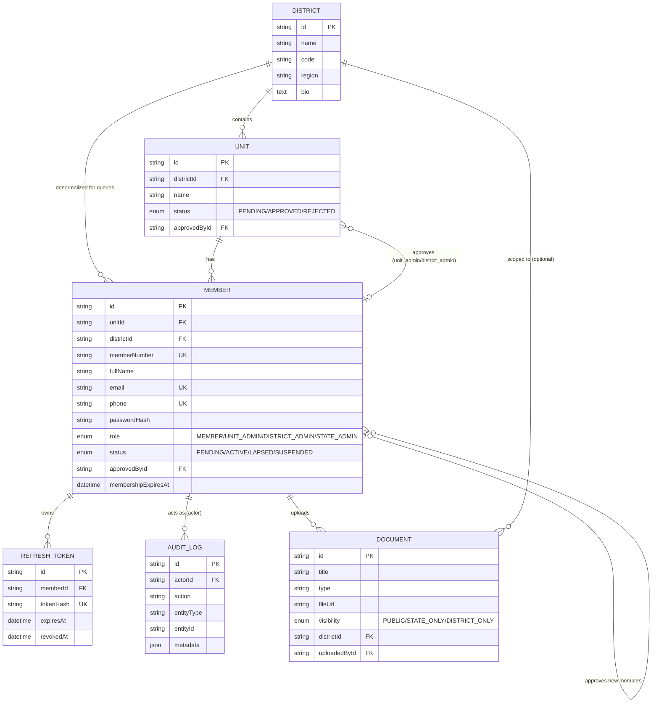
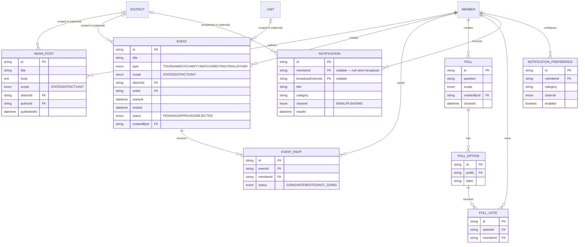
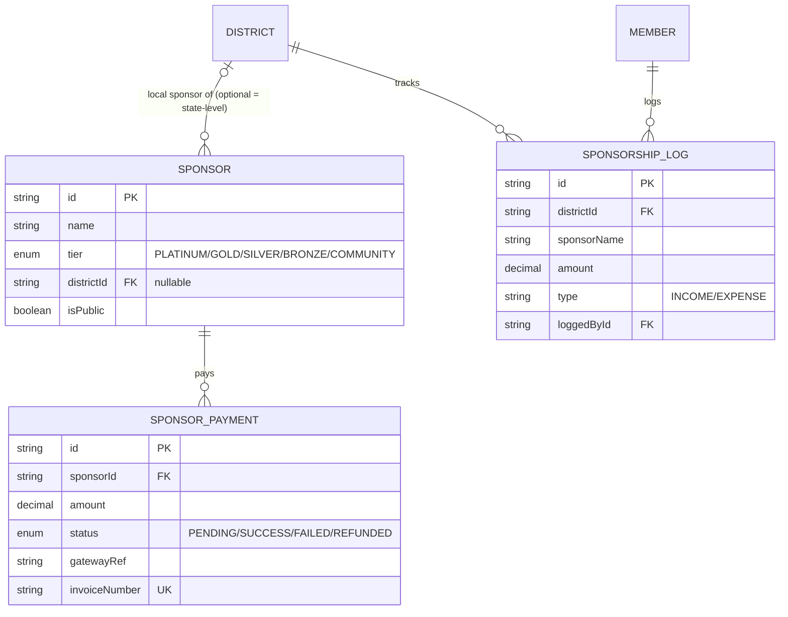
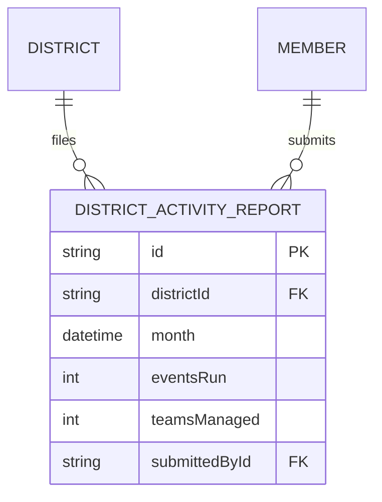
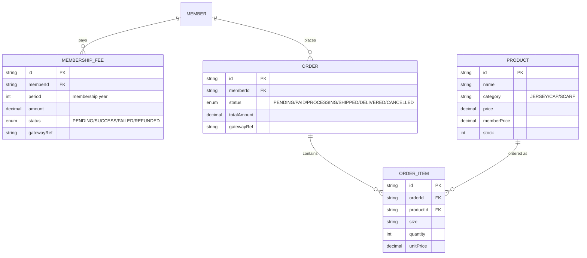
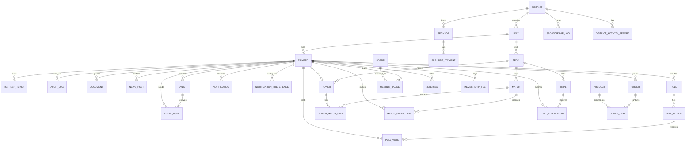

# AKDFA — Entity Relationship Diagrams

Source of truth for the schema is [`backend/prisma/schema.prisma`](../../backend/prisma/schema.prisma). These diagrams are a human-readable view of the same model, grouped by phase so each one stays legible. A full master diagram (entities + relationships only, no columns) is at the bottom.

Regenerate an interactive version anytime with `npx prisma studio` (needs `DATABASE_URL` set) or `npx prisma-erd-generator` against the schema file. The exact DDL is in [`SCHEMA.sql`](SCHEMA.sql).

### Changes since first draft (not all redrawn below)

- **PII encryption**: `MEMBER.email/phone` are AES-GCM ciphertext with `emailHash` / `phoneHash` blind-index columns for lookup; `MEMBER.dateOfBirth` is an encrypted string; `UNIT` / `SPONSOR` contact fields, `SPONSORSHIP_LOG` text, `DOCUMENT.fileKey`, `NEWSLETTER_SUBSCRIBER.email`, `CONTACT_MESSAGE` and `FEEDBACK` bodies are encrypted.
- **`DOCUMENT`**: `fileUrl` → `fileKey` (private on-disk name) plus `mimeType` / `originalName` / `fileSize`.
- **New entities**: `PASSWORD_RESET` (Member 1—* ), `FEEDBACK` (Member/Unit), `CHARITY_REPORT` (Event 1—1), plus `EVENT.photos[]` / `EVENT.bracket` / `MATCH.photos[]`, `MEMBER.renewalReminderAt`, `SPONSOR_PAYMENT.payToken` / `note` / `paidAt`.
- **`MembershipStatus`** gains `REJECTED`.

## 1. Org structure & auth (Phase 0/1)



## 2. Content & engagement (Phase 1/2)



## 3. Cricket hub (Phase 2/3)

```mermaid
erDiagram
    UNIT ||--o{ TEAM : fields
    MEMBER |o--o{ TEAM : captains
    TEAM ||--o{ PLAYER : rosters
    MEMBER ||--o| PLAYER : "is (one profile)"
    TEAM ||--o{ MATCH : "plays as home"
    TEAM ||--o{ MATCH : "plays as away"
    EVENT |o--o{ MATCH : "part of (optional)"
    MATCH ||--o{ PLAYER_MATCH_STAT : records
    PLAYER ||--o{ PLAYER_MATCH_STAT : has
    MATCH ||--o{ MATCH_PREDICTION : receives
    MEMBER ||--o{ MATCH_PREDICTION : makes
    TEAM ||--o{ TRIAL : holds
    EVENT |o--o{ TRIAL : "part of (optional)"
    TRIAL ||--o{ TRIAL_APPLICATION : receives
    MEMBER ||--o{ TRIAL_APPLICATION : submits

    TEAM {
        string id PK
        string unitId FK
        string name
        string season
        string captainId FK
    }
    PLAYER {
        string id PK
        string memberId FK UK
        string teamId FK
        int jerseyNumber
        string position
    }
    MATCH {
        string id PK
        string eventId FK
        string homeTeamId FK
        string awayTeamId FK
        datetime scheduledAt
        enum status "SCHEDULED/LIVE/COMPLETED/CANCELLED"
        string resultSummary
    }
    PLAYER_MATCH_STAT {
        string id PK
        string matchId FK
        string playerId FK
        int runs
        int wickets
        int catches
    }
    MATCH_PREDICTION {
        string id PK
        string matchId FK
        string memberId FK
        string predictedWinnerTeamId
    }
    TRIAL {
        string id PK
        string teamId FK
        string eventId FK
        datetime scheduledAt
    }
    TRIAL_APPLICATION {
        string id PK
        string trialId FK
        string memberId FK
        enum status "APPLIED/SHORTLISTED/SELECTED/REJECTED"
    }
```

## 4. Sponsors (Phase 1/3/5)



## 5. Badges & referrals (Phase 2)

```mermaid
erDiagram
    MEMBER ||--o{ MEMBER_BADGE : earns
    BADGE ||--o{ MEMBER_BADGE : "awarded as"
    MEMBER ||--o| REFERRAL : "refers (as referrer, many)"
    MEMBER ||--|| REFERRAL : "is referred (as referred, one)"

    BADGE {
        string id PK
        string name UK
        string criteria
    }
    MEMBER_BADGE {
        string id PK
        string memberId FK
        string badgeId FK
        datetime awardedAt
    }
    REFERRAL {
        string id PK
        string referrerId FK
        string referredId FK UK
        enum status "PENDING/JOINED/REWARDED"
        datetime rewardGrantedAt
    }
```

## 6. District → state reporting (Phase 4)



## 7. Payments & store (Phase 5)



## Master diagram (entities + relationships only)


